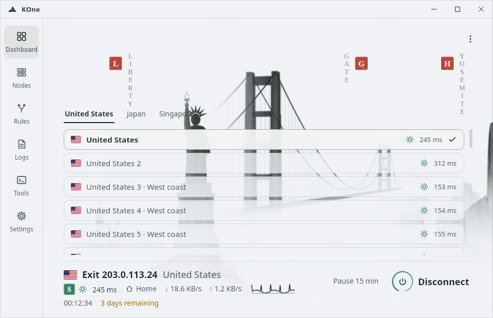
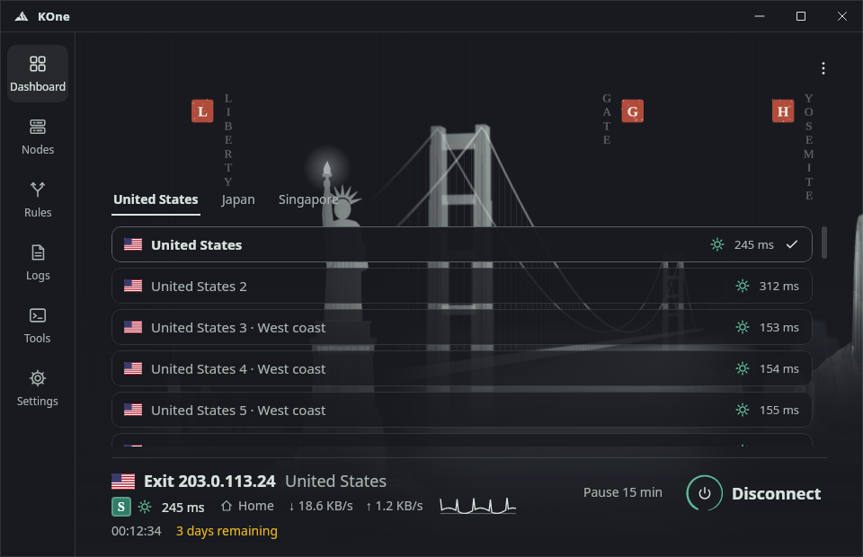

# Windows dashboard and responsiveness review

Based on `claude/windows-desktop` at `d4011c9`, including the Windows 1.0.70
language work. `main` remains the Android baseline; the independent node
continuity PR is not included in this change.

The dashboard now has a bounded, virtualized node deck with aligned targets,
selection outlines, an accessible scrollbar and horizontally scrollable country
tabs. Long node names yield space to latency and selection controls. Connection
metrics wrap, and the footer stacks at narrow content widths. Logs uses a wrapping
toolbar, cached severity patterns and snapshot-aware filtering. Pausing holds a
copy; resuming and capped-list rollover refresh the filtered output.

Traffic and clock updates now copy telemetry into the dashboard instead of
rebuilding node health, country groups and subscription sections each tick.
Structural updates continue through the existing full refresh. This removes
specific work from frequent updates; it is not a measured Windows frame-rate claim.

City content, dynamic backgrounds, motion parameters, localization, personal
assets, connection behavior and release configuration are unchanged.

## Reference renders

Synthetic Linux Compose renders at 960 by 620, with a large sample subscription.
These are not Windows screenshots or live connection evidence.

## Reproduction

From `desktop`, run `./gradlew test`. There is no desktop lint task configured;
Kotlin compilation and `git diff --check` provide source checks. To regenerate
these renders alone, run `./gradlew test --tests cc.txwd.kone.ScreensTest.dashboardDeck`.
The test also renders at 1280 pixels in both themes.

The cloud executor needs the session HTTP proxy passed as Java system properties.
Its home directory is read-only, so an external Gradle init script sets only the
test JVM's `user.home` to a writable temporary test directory for Skiko extraction.
No dependency stubs, production settings or repository build changes are used.

New regression checks cover 1,000 nodes with fewer than 20 composed node entries,
scrolling and selecting the last row, repeated country changes, narrow online
controls, log filtering/pause/resume/clear, severity boundaries, and retaining the
node/subscription snapshots through 60 telemetry refreshes.

Windows-native rendering, hardware performance, real screen readers, installer
and live tunnel behavior require a Windows machine. The repository's Windows
workflows are manual-only; this work does not enable or dispatch paid runners.

## Executed checks

Full desktop JVM suite on Linux, JDK 21, with real dependencies: 291 tests, 0 failures, 0 errors, 14 gated skips. Includes shared tests, Chinese screens at 100%, 150% and 200%, keyboard, accessibility, background motion and hidden-window checks. Source compilation and `git diff --check` pass. Existing Kotlin deprecation warnings and nonfatal Fontconfig cache warnings remain.
